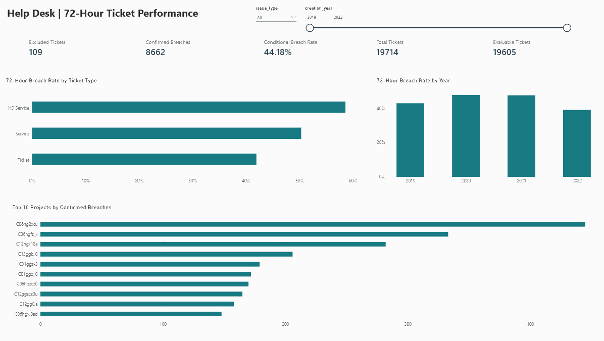
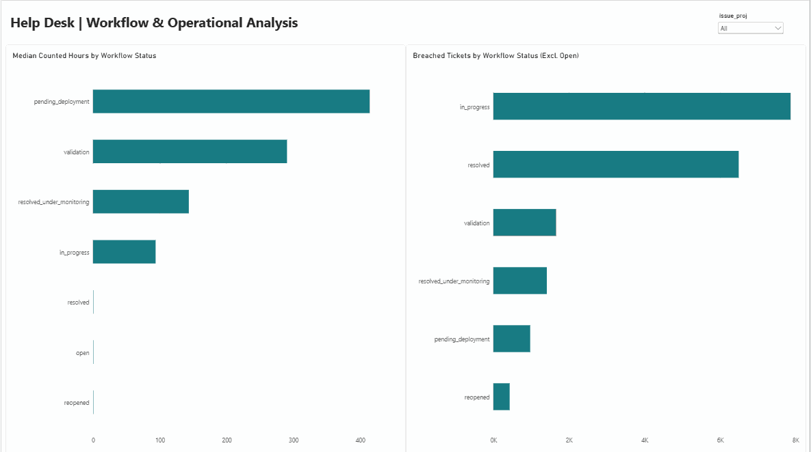

# Help Desk Ticket Performance Analysis

**End-to-end portfolio case study | Python · PostgreSQL/SQL · Power BI**

## Business question

Which ticket groups and workflow stages warrant investigation when a help-desk ticket exceeds a **project-defined 72 counted-calendar-hour target** before closure?

This is a **historical, descriptive and diagnostic** analysis—not a live service-monitoring system, a verified company SLA, or a causal study. The Operations Manager perspective is simulated for an academic portfolio exercise.

## Project at a glance

| Measure | Result |
|---|---:|
| In-scope tickets created in 2019–2022 | **19,714** |
| Confirmed 72-hour breaches under working Rule B | **8,662** |
| Observed closures without breach | **10,943** |
| Evaluable tickets | **19,605** |
| Censored or indeterminate, excluded from the KPI denominator | **109** |
| **Conditional breach rate** | **44.18%** |

**Definition:** 8,662 / 19,605 = 44.1826%. This is the proportion **among classifiable historical tickets**, not a contractual SLA measurement. The excluded tickets were **not** treated as successes.

## Dashboard preview

Static views of the historical Power BI report (2019–2022). The **44.18%** headline KPI is conditional under the project's Rule B, **not** a verified contractual SLA.

### Executive Overview



### Workflow & Operational Analysis



These are screenshots, not interactive dashboards. The Power BI project file is available in [`powerbi/`](powerbi/); opening and refreshing it requires Power BI Desktop and compatible PostgreSQL reporting views. **The imported PBIX data model is not cleared for independent redistribution by the privacy screen; prefer the aggregate screenshots when sharing the portfolio.**

## Selected findings

- **Ticket type:** `HD Service` has the highest conditional rate (**58.64%**), while the more common `Ticket` type contributes the highest breach count (**6,607**).
- **Time:** The observed conditional rate is **47.74% in 2021** and **39.18% in 2022**. Reweighting 2022 to the 2021 evaluable ticket-type mix yields **39.88%**; this is not evidence of causation or confirmed operational improvement.
- **Project groups:** Anonymized project `C06hgfz_x` has **333 breaches / 434 evaluable tickets (76.73%)**; `C06hqzcz0` has **170 / 200 (85.00%)**. Group sizes and uncertainty matter.
- **Workflow:** Among *already-breached* tickets with positive counted time in a status, the median is **414.16 h in `pending_deployment` (n=973)** and **290.42 h in `validation` (n=1,659)**. Status residence time is not employee working time or proof of a root cause.

See [Findings and Recommendations](docs/Findings_and_Recommendations.md) for supporting denominators, investigation proposals, and interpretation limits.

## Approach and deliverables

1. **Python:** Parsed mixed-format timestamps, reconstructed observed ticket status intervals, applied conservative outcome classifications and a 72-hour clock, and tested assumptions.
2. **SQL/PostgreSQL:** Reconciled results, examined year/type/project patterns and workflow durations, conducted A/B sensitivity checks, and created two Power BI reporting views.
3. **Statistics:** Used conditional proportions, ticket-type standardization, medians, and explicit uncertainty/exclusion handling.
4. **Power BI:** Built an *Executive Overview* and an *Operational Deep Dive* using `analytics.vw_ticket_performance` and `analytics.vw_ticket_workflow`.

### Measurement assumptions

- **Working Rule B:** counted time continues through `resolved` until an observed `closed` transition; `waiting` pauses the clock, and `pending_customer_approval` is **provisionally** paused. An explicit reopening resumes the cumulative clock.
- **Rule A:** stops at `resolved`; used as a sensitivity comparison.
- The threshold is **strictly greater than 72 counted hours** at any observed point. Unconfirmed cases remain censored or indeterminate.
- No verified dataset extraction timestamp exists; no unobserved future time is added to the primary KPI.
- The academic supervisor supplied the target while acting as a **simulated Operations Manager**. Rules were not validated by the source organization.

Further details: [Cleaning and Transformation Rules](docs/Cleaning_and_Transformation_Rules.md) and [Terminology](docs/Terminology_and_File_Guide.md).

## Repository map

| Path | Contents |
|---|---|
| [`python/`](python/) | Event reconstruction, audit helper, unit tests, export validation, PostgreSQL CSV preparation |
| [`sql/`](sql/) | Staging-table DDL/import assertions plus 19 numbered analysis/QA/view-definition SQL scripts |
| [`powerbi/`](powerbi/) | Power BI Desktop report with two pages; refresh requires a suitable PostgreSQL environment |
| [`docs/`](docs/) | Findings, business rules, terminology, original decision log, methodology and dashboard screenshots |
| [`data/derived/`](data/derived/) | Generated CSV/JSON snapshots based on CC BY 4.0 source data; privacy review still recommended |
| [`results/`](results/) | Saved test-results log |

Two dashboard previews are included under [`docs/images/`](docs/images/). The `.pbix` contains an imported row-level data model; see the [Privacy Review](docs/Privacy_Review.md) before downloading, reusing, or redistributing it.

## Run Python locally

**Requirements:** Python 3.13 and the `pandas` and `numpy` packages (tested locally with pandas 2.3.3 and NumPy 2.2.6).

```powershell
python -m pip install pandas numpy
python -m unittest discover -s python -p "test_*.py" -v
python python/helpdesk_domain3_measurement.py "C:\path\to\Help Desk Tickets.zip" "local_output"
python python/verify_exported_results.py "local_output"
python python/prepare_postgres_csv.py "local_output/ticket_outcomes_conditional.csv" "local_output/ticket_outcomes_postgres.csv"
```

The **source archive is not included**. Its internal layout must contain `Help Desk Tickets/issues.csv` and `Help Desk Tickets/issues_change_history.csv`. The scripts do not overwrite the source archive. Outputs are generated locally.

**Prior local validation:** 14 synthetic unit tests passed; 16 exported-result assertions passed. The saved evidence is in [`results/TEST_RESULTS.txt`](results/TEST_RESULTS.txt). Those are recorded local results, not claims of a new CI run.

## SQL and Power BI reproducibility

The analytical SQL files use staging tables `staging.ticket_outcomes` and `staging.status_intervals`. Files `18_ticket_performance_view.sql` and `19_ticket_workflow_view.sql` build the reporting views.

**Fresh PostgreSQL setup is now documented:** [PostgreSQL Reproduction Guide](docs/PostgreSQL_Reproduction_Guide.md) gives the setup, import and verification commands. The two new SQL scripts [`00_create_staging_tables.sql`](sql/00_create_staging_tables.sql) and [`00_verify_staging_import.sql`](sql/00_verify_staging_import.sql) define the 35/10-column staging schemas and check the imported data. A [GitHub Actions smoke test](.github/workflows/postgres-repro-check.yml) provisions PostgreSQL 18, imports the published derived CSV snapshots, builds the reporting views and validates counts. This smoke test verifies the SQL import path—not full source-ZIP regeneration or manual Power BI refresh. Do not commit passwords or local DB credentials.

## Dataset source and attribution

**Original dataset:** Abdellatif, Mohammad (2026). *Help Desk Tickets*. **Mendeley Data, Version 3**. DOI: [10.17632/btm76zndnt.3](https://doi.org/10.17632/btm76zndnt.3). [Dataset record](https://data.mendeley.com/datasets/btm76zndnt/3).

**Source license:** [Creative Commons Attribution 4.0 International (CC BY 4.0)](https://creativecommons.org/licenses/by/4.0/). Credit for the underlying dataset belongs to its contributor, **Mohammad Abdellatif**. Its published files are described as curated and partly masked/anonymized by the contributor.

**Changes in this portfolio:** This analysis is **not** the unmodified original dataset or the original author's study. I restricted the analytical population to external-project `Ticket`, `Service`, and `HD Service` records created in **2019–2022**; parsed timestamps to UTC; reconstructed observed status-event intervals; implemented and tested a **project-defined** cumulative 72-hour Rule B and Rule A comparator; excluded unclassifiable tickets from the conditional denominator; and created derived CSV/JSON results, SQL reporting views, and Power BI visualizations.

**Attribution and responsibility:** This portfolio is an independent educational analysis and is **not endorsed by the source author, the data provider, or the source company**. The derived data are shared under the source's CC BY 4.0 attribution obligations where applicable; reuse should retain this attribution and the modification notice. License permission does not remove the need to avoid publishing sensitive personal or confidential information. The exact locally downloaded source-file version has not been independently verified by checksum; **Version 3 is the public release cited here**, not a claimed checksum match.

## Data, ethics and limits

- The dataset describes archived 2019–2022 tickets, not current operational performance.
- The conditional rate depends on working closure/pausing rules; it must **not** be presented as an approved company KPI.
- The 109 excluded tickets consist of **40 censored, 62 semantic, and 7 data-quality indeterminate** cases.
- Workflow delays are **investigation candidates**, not diagnosed root causes, employee labor hours, financial losses, or proven intervention opportunities.
- The GitHub history contains derived CSV exports and an imported Power BI model. An [automated privacy screen](.github/workflows/privacy-audit.yml) scans published CSV values and the readable PBIX package metadata for direct-identifier patterns; this **cannot certify anonymization or inspect the complete embedded DataModel**. Read the [Privacy Review](docs/Privacy_Review.md) before redistributing row-level artifacts. Moving or deleting files does not erase earlier Git history.

**Status:** Analyzed and documented portfolio case study; no company validation, deployment, or measured business intervention.
